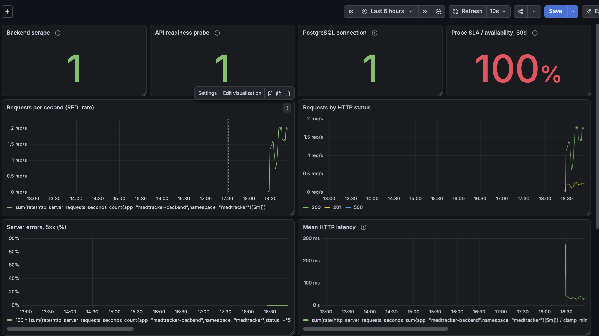
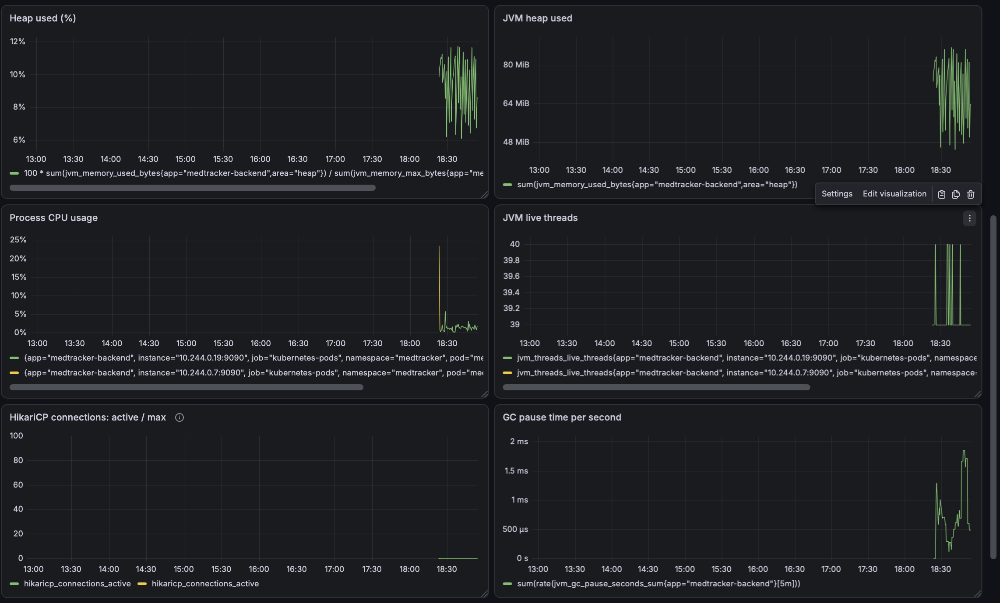
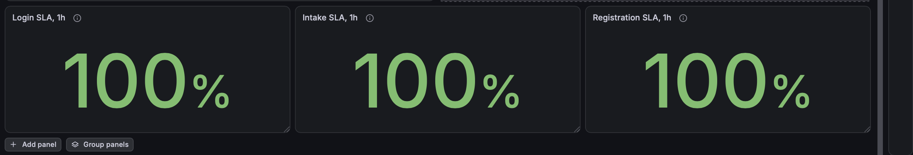
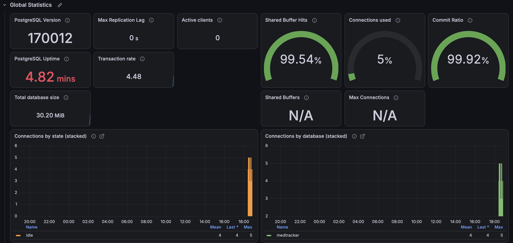
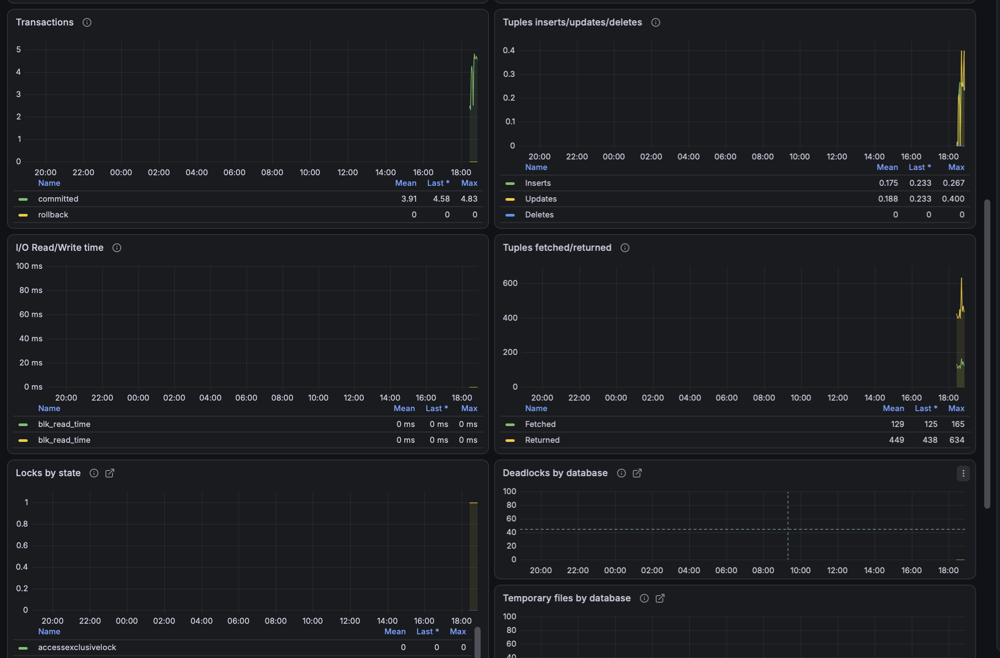

# Отчёт: дашборды Grafana для Home Medicine Tracker

## Источники данных

В Grafana настроен источник **VictoriaMetrics** через совместимый с Prometheus API. `vmagent` каждые 15 секунд собирает метрики и записывает их в VictoriaMetrics. Дашборды читают данные из этого источника:

| Откуда поступают метрики | Что используется |
| --- | --- |
| Spring Boot Actuator `/actuator/prometheus` | HTTP-запросы, бизнес-счётчики, JVM, CPU, пул соединений HikariCP |
| Blackbox Exporter, проверка `/actuator/health/readiness` | `probe_success` — доступность API с проверкой подключения к БД |
| PostgreSQL Exporter в pod `postgres-0` | `pg_up`, соединения, транзакции, буферы, размер и активность БД |

Конфигурации: [источник Grafana](../k8s/metrics/grafana-values.yaml), [сбор метрик vmagent](../k8s/metrics/vmagent-values.yaml).

## Дашборд приложения

Дашборд **MedTracker Observability** объединяет состояние сервиса и пользовательские операции:

| Панели | Метрики и причина выбора |
| --- | --- |
| Backend scrape, API readiness probe, PostgreSQL connection | `up`, `probe_success`, `pg_up` позволяют быстро отличить отсутствие метрик, недоступность API и проблему БД. |
| Requests per second, Requests by HTTP status | Скорость `http_server_requests_seconds_count` показывает нагрузку и распределение ответов. Это **Rate** из RED. |
| Server errors, 5xx (%) | Доля серверных ошибок показывает **Errors** из RED и Golden Signals. |
| Mean HTTP latency | Среднее время ответа по `http_server_requests_seconds_sum/count` показывает **Duration/Latency**. |
| Heap used, JVM heap used, Process CPU usage, JVM live threads, HikariCP connections, GC pause time | Детализация использования ресурсов (**USE**): помогает искать причину замедления и оценивать запас памяти, CPU и соединений. |
| Probe SLA / availability, 30d | `100 × avg_over_time(probe_success[30d])` — отдельная оценка доступности по успешным проверкам. Она считается по имеющимся измерениям за последние 30 дней. |
| Login, Intake, Registration SLA, 1h | Доля измеренных минут за час, когда пятиминутный SLI операции достигал учебной цели 85%. Короткий период нужен для демонстрации; условие SLA из [задания №5](Отчёт5.md) задано на 30 дней. |

На обзорном снимке сбор метрик, readiness и подключение к PostgreSQL имеют значение `1`; при тестовой нагрузке видны запросы и время ответа.

Панель доступности пробера находится в верхнем ряду первого снимка. Бизнес-SLA показаны отдельно:

## Дашборд PostgreSQL Exporter

Импортирован и адаптирован готовый дашборд **PostgreSQL Exporter (MedTracker)**. Его основные панели показывают версию и время работы PostgreSQL, число и заполнение соединений, попадания в shared buffers, долю commit, размер БД, скорость транзакций, операции с таблицами, блокировки и deadlock. Они помогают увидеть нагрузку на БД и возможные узкие места.

На снимках видны данные о транзакциях, соединениях и операциях с записями: экспортёр работает. После запуска PostgreSQL панель uptime показывает 4,82 минуты, поэтому пустой участок графиков до запуска ожидаем.
