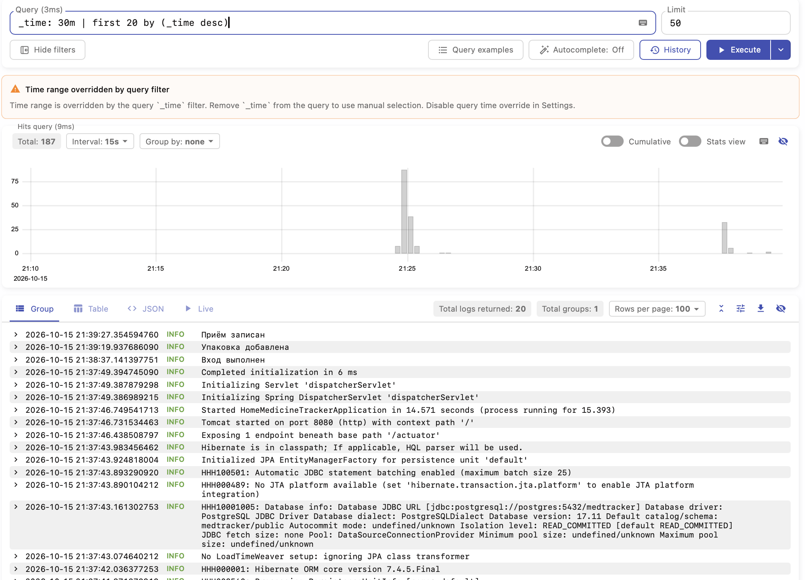
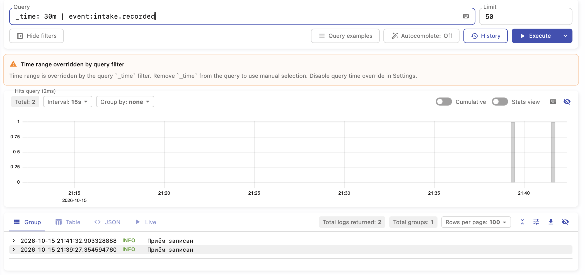
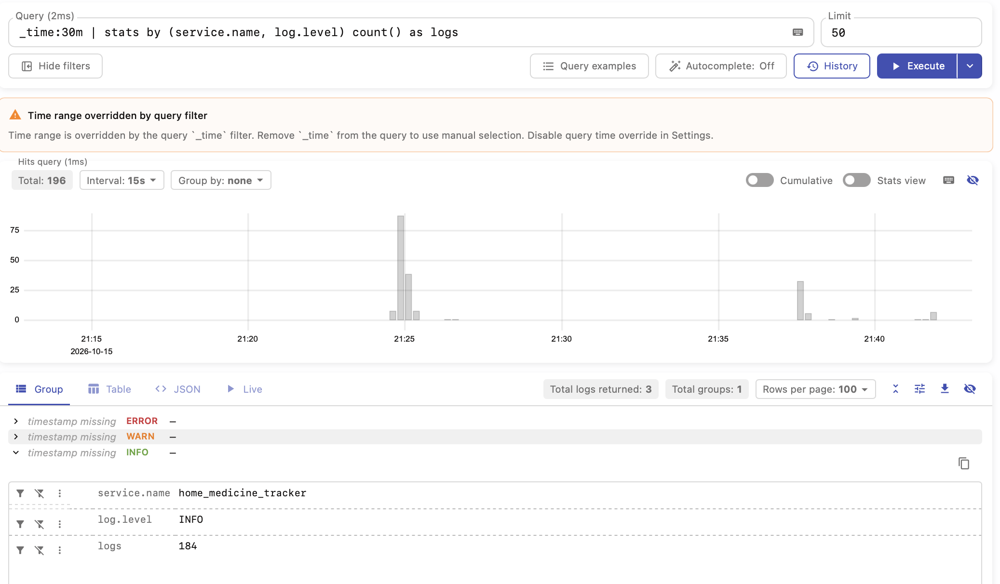
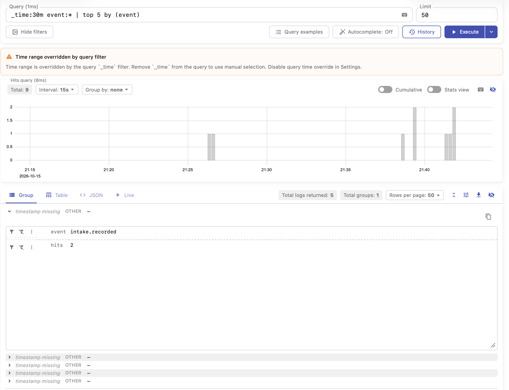

# Подключение Victoria Logs к приложению

Для централизованного сбора логов используется связка Fluent Bit + VictoriaLogs. Приложение выводит логи в консоль в формате
JSON, Kubernetes сохраняет их в файлы на узле, а Fluent Bit считывает и отправляет в VictoriaLogs.

Fluent Bit разворачивается через DaemonSet, то есть по одному экземпляру на каждый подходящий узел кластера. Такой подход 
позволяет собирать логи независимо от состояния приложения, в том числе при ошибках запуска и аварийном завершении. 
При этом сохраняется возможность просмотра через kubectl logs. А также был выбран DaemonSet, потому что Fluent Bit
может таким образом читать логи со всех подов на узле и сразу отправлять в систему хранения логов. 

Fluent Bit выбран благодаря небольшому потреблению ресурсов, простой конфигурации и возможности использовать практически 
одинаковые настройки в Docker Compose и Kubernetes.

VictoriaLogs поддерживает API, совместимые с Elasticsearch и Loki, однако в проекте используется нативный JSON API.
Это позволяет передавать JSON-логи напрямую, без дополнительных преобразований и служебных данных, необходимых для
совместимых форматов. Также можно задавать поля группировки логов непосредственно при отправке. Также при таком 
подходе не было необходимости переписывать приложение и добавлять возможность отправки логов напрямую в систему
сбора логов. 

В общем это был достаточно простой и удобный вариант настройки сборки логов для маленького приложения

## Сырые записи за последние N минут

---
Показывает записи логов за последние 30 минут

## Фильтр по полю

---
Фильтр по полю типа события за последние 30 минут

## Stats-запрос с группировкой по имени сервиса и по уровню логов

---

Показывает три уровня логов по сервису с их количеством за последние 30 минут

## Агрегирующий запрос

---

Показывает топ 5 запросов по количеству по полю event (тип события) за последние 30 минут

